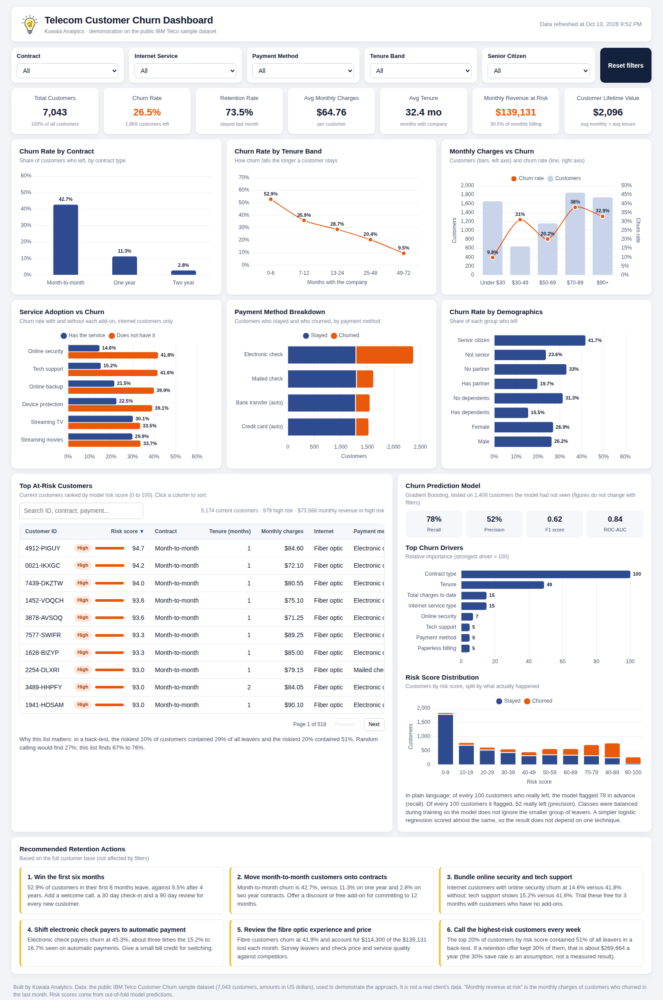

# Telecom Customer Churn and Retention Analysis

A Kuwala Analytics portfolio project: who is leaving a telecom business, how much revenue goes with them, and which customers to call first.

**Live dashboard:** https://kuwalaanalytics.github.io/telecom-churn-retention-analysis/



> **About the data.** This project uses the public IBM Telco Customer Churn sample dataset (7,043 customers, amounts in US dollars). It demonstrates the approach. It is not a real client's data and no client results are claimed.

## Headline findings

- 26.5% of customers left in the last month, taking $139,131 of monthly revenue with them (30.5% of monthly billing).
- Month-to-month customers churn at 42.7%, against 11.3% on one year and 2.8% on two year contracts.
- 52.9% of customers in their first 6 months leave. After 4 years it is 9.5%.
- Internet customers with online security churn at 14.6%, against 41.8% without it.
- The riskiest 20% of customers, as ranked by the model, contained 51% of all leavers.

The full write-up is in [portfolio/case-study.md](portfolio/case-study.md), and the client report is in [reports/](reports/) as a PDF and a Word document.

## Open the dashboard

Double-click `dashboard/index.html`. It is one file with the data, charts and logo embedded, so it works offline in any modern browser.

## Reproduce everything

```bash
python -m venv .venv
.venv/bin/pip install -r requirements.txt
.venv/bin/python src/prepare.py          # clean the raw file, add features
.venv/bin/python src/analysis.py         # analysis, segments, model, risk scores
.venv/bin/python src/build_dashboard.py  # dashboard/index.html
.venv/bin/python src/make_charts.py      # social media chart images (needs Chrome for kaleido)
.venv/bin/python src/make_report.py      # client report as Word and PDF (needs LibreOffice)
```

## Project layout

| Path | What it holds |
|---|---|
| `data/raw/` | The original CSV, untouched |
| `data/clean/` | Cleaned data, scored data, `data_profile.json` (schema and cleaning log), `findings.json` (every number quoted) |
| `src/` | The five scripts above, the dashboard template and the embedded Chart.js library |
| `dashboard/index.html` | The interactive dashboard |
| `portfolio/` | Case study, social media copy and chart images |
| `reports/` | The client report as a Word document and a PDF |
| `powerbi/` | Optional pack for rebuilding the dashboard in Power BI Desktop: data files, DAX measures, theme and build guide |
| `assets/` | Kuwala Analytics logo |

## Cleaning decisions

- `TotalCharges` arrives as text. Its 11 blank values all belong to customers with 0 months of tenure, so they were set to 0 and kept.
- `SeniorCitizen` was recoded from 0/1 to No/Yes.
- No duplicate rows or customer IDs were found, and no other values were missing.
- Add-on comparisons use internet customers only, because customers without internet cannot buy add-ons.

## Method notes

- Three models were compared on a 20% holdout: logistic regression, random forest and gradient boosting. Class imbalance was handled with balanced class weights.
- Risk scores are out-of-fold predictions from 5-fold cross-validation, so no customer is scored by a model trained on their own record.
- Revenue figures for "saving" customers are scenarios with a stated save rate. They are not measured campaign results.

## Tools

Python, pandas, scikit-learn, Plotly, Chart.js, HTML, CSS and JavaScript.
