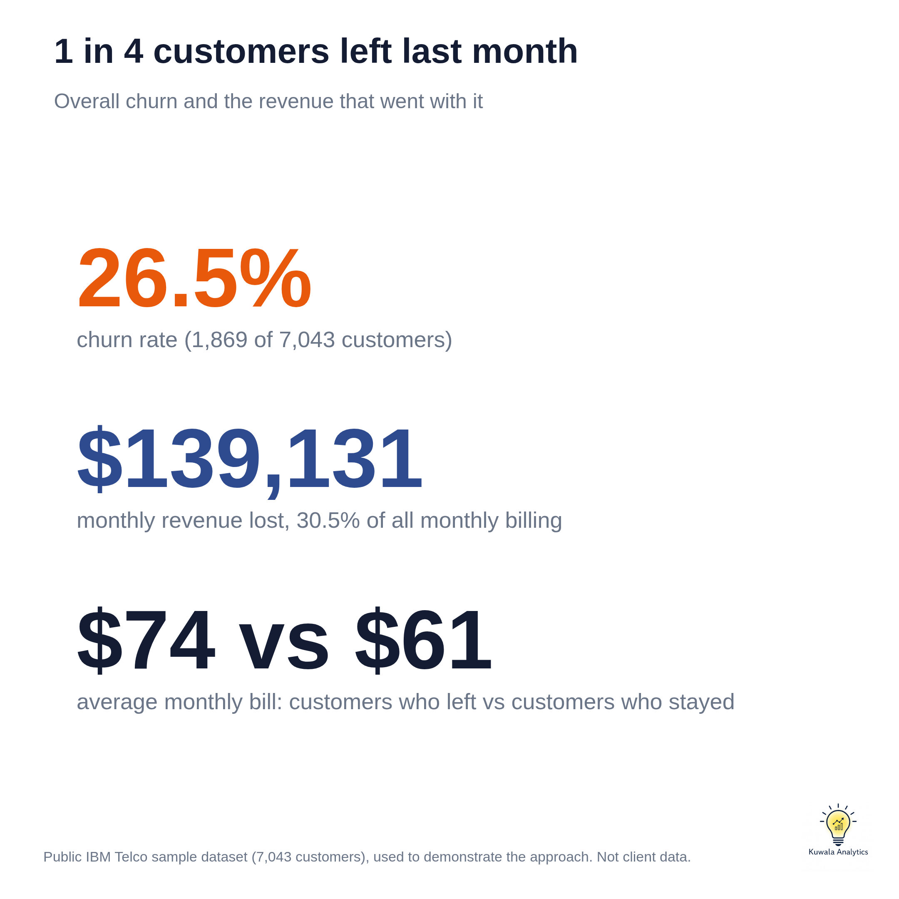
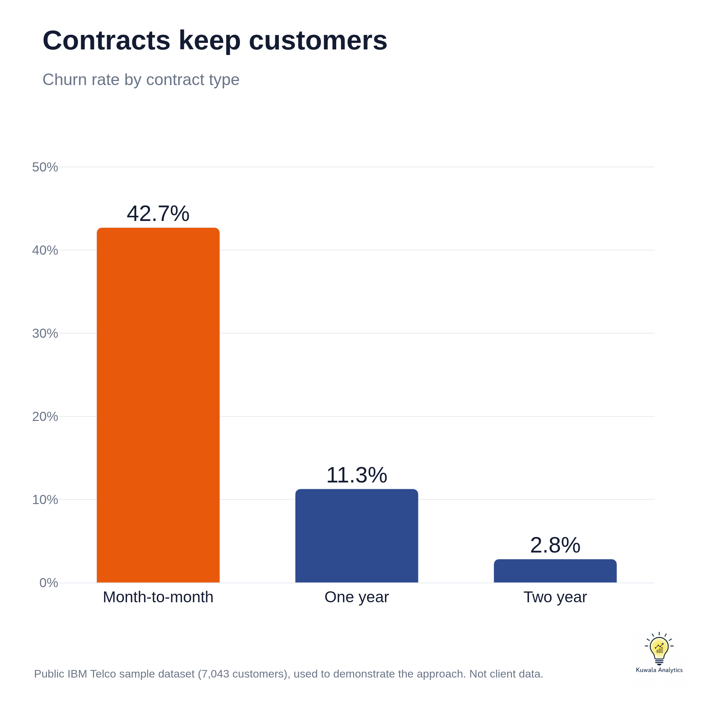
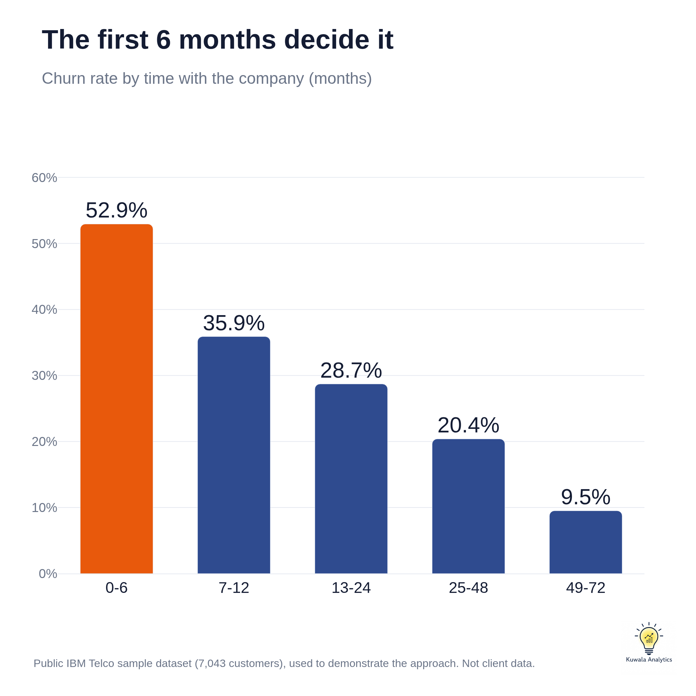
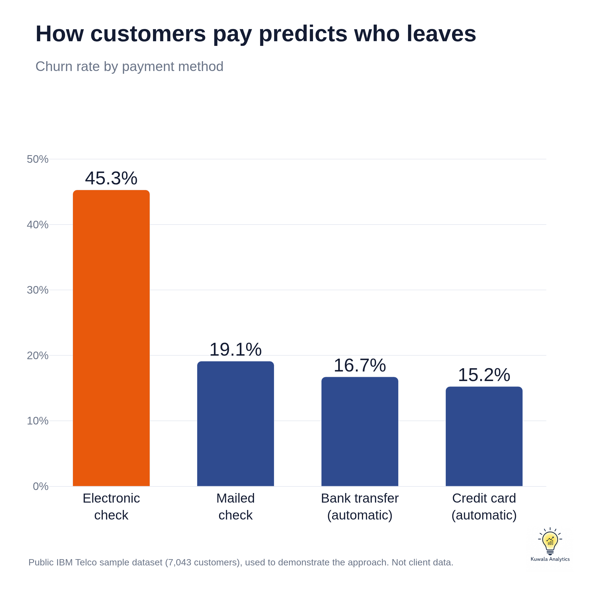
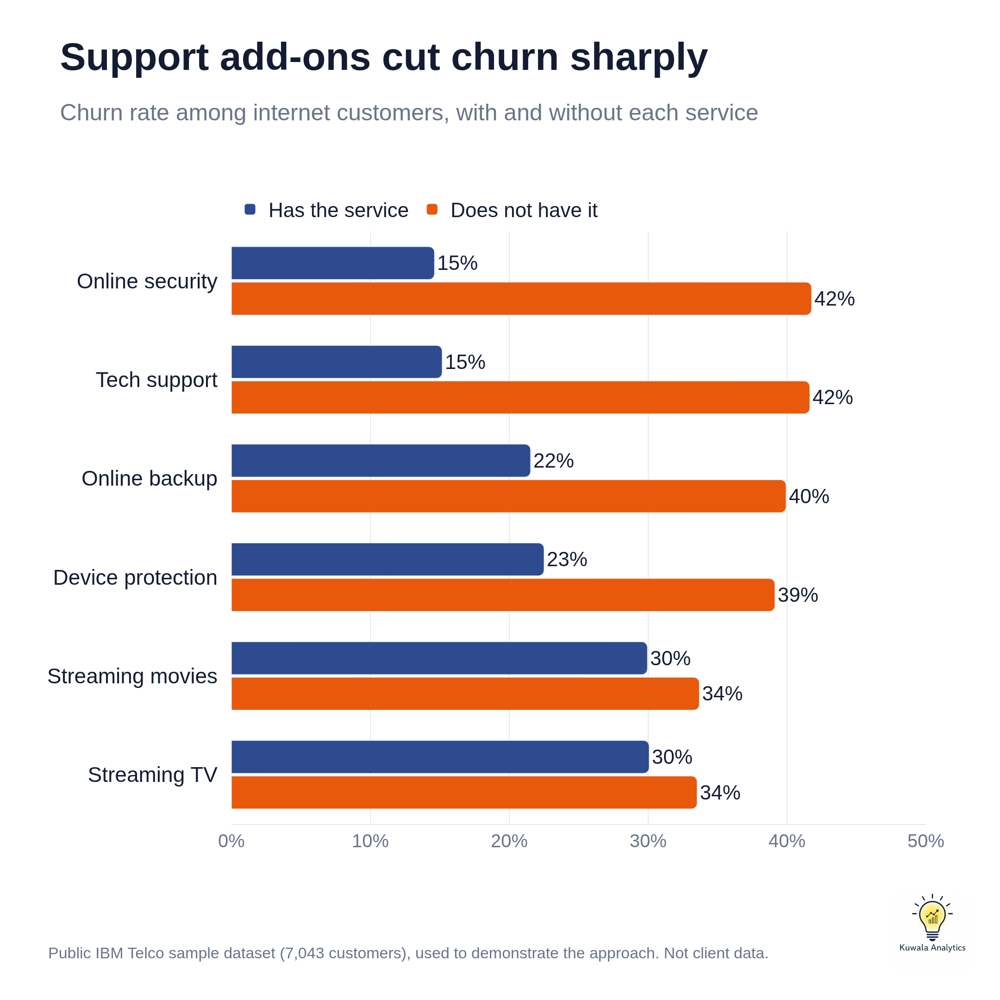
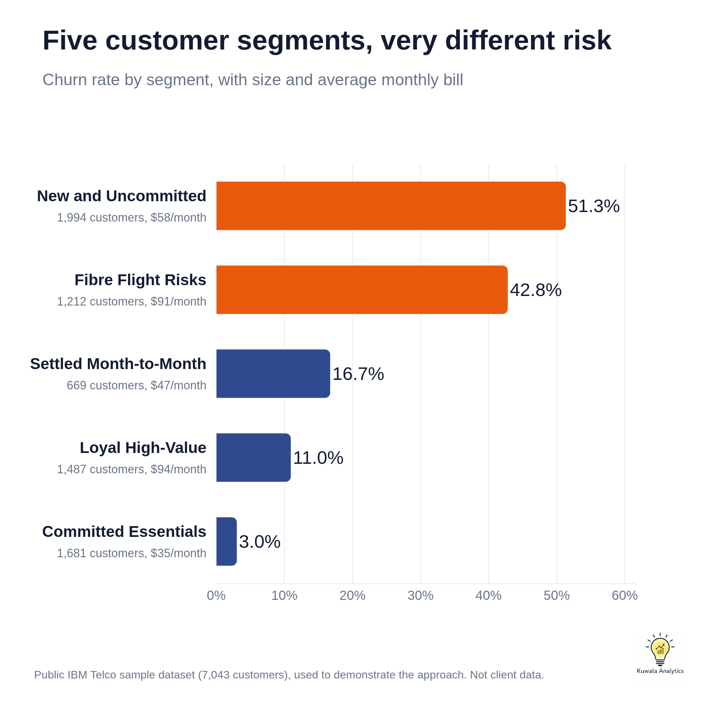
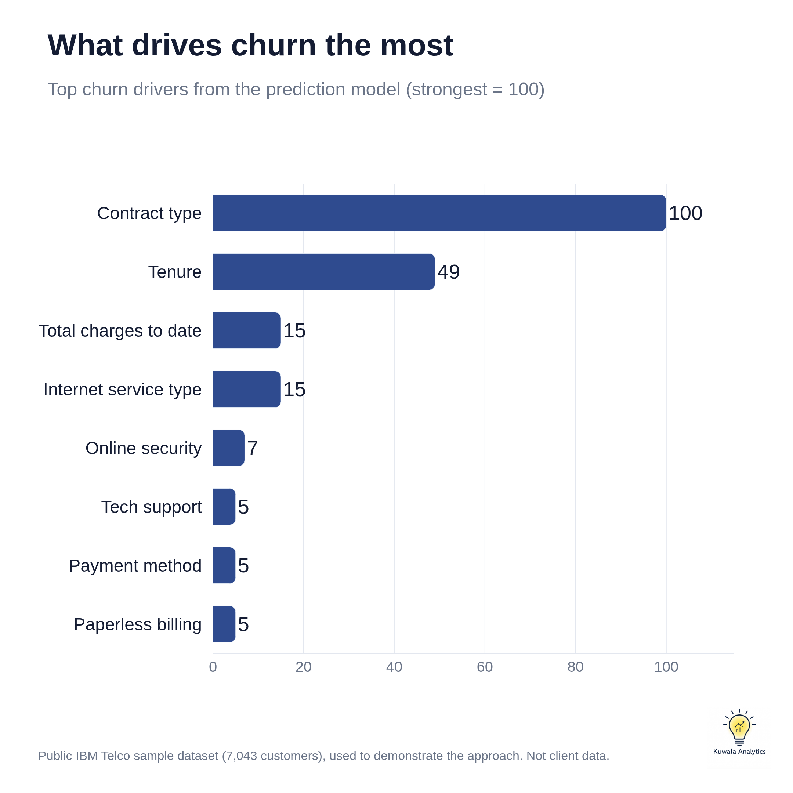
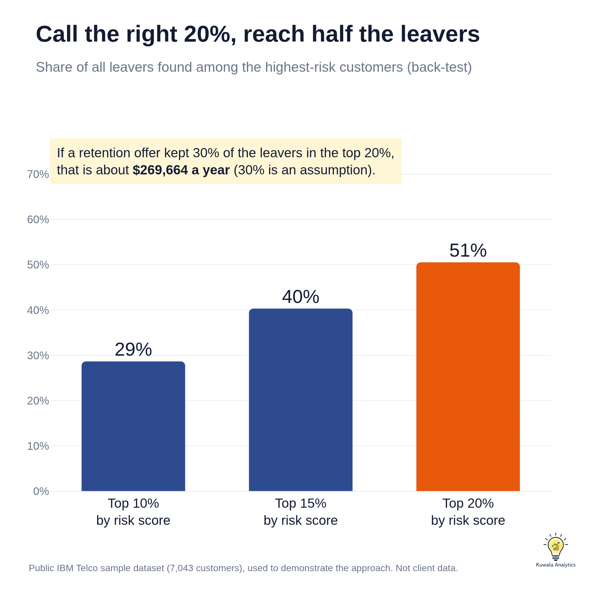

# Case Study: Finding and Keeping the Customers Most Likely to Leave

**By Kuwala Analytics**

**Live dashboard:** https://kuwalaanalytics.github.io/telecom-churn-retention-analysis/

> **A note on the data.** This case study uses the public IBM Telco Customer Churn sample dataset. It shows how Kuwala Analytics approaches a churn problem. It is not a real client's data, and the figures below are not results achieved for any client. Amounts are in US dollars, as in the dataset.

## Problem

A telecom or subscription business loses customers every month. Winning a new customer usually costs more than keeping an existing one, yet most businesses cannot say who is about to leave, why, or how much revenue is walking out with them.

The owner needs answers to four questions:

1. How many customers are we losing, and what does it cost each month?
2. Which kinds of customers leave most often?
3. Which individual customers should we call this week?
4. What is it worth if we keep some of them?

## Data

- 7,043 customers, one row each, 21 columns.
- A churn flag marking customers who left in the last month.
- Services: phone, multiple lines, internet type, online security, online backup, device protection, tech support, streaming TV and streaming movies.
- Account details: tenure, contract type, payment method, paperless billing, monthly charges and total charges.
- Demographics: gender, senior citizen, partner and dependents.

Data quality was good. There were no duplicate customers. The only gap was 11 blank total charge values, all belonging to brand new customers who had not yet been billed. These were set to 0 and kept.

## Method

1. **Clean and prepare.** Fixed data types, handled the 11 blanks, and added tenure bands, monthly charge bands, a count of services and a flag for customers with no add-ons. Every decision is logged.
2. **Explore.** Measured churn rate and lost revenue across contract, tenure, payment method, internet type, billing and demographics.
3. **Segment.** Grouped customers into five named segments using simple rules a sales or service team can apply without a data scientist.
4. **Predict.** Trained three models to score every customer's risk of leaving, corrected for the fact that leavers are the smaller group, and tested on customers the models had never seen.
5. **Value.** Estimated the revenue protected by contacting only the highest-risk customers.
6. **Deliver.** Built a one-file interactive dashboard with filters, KPIs, an at-risk customer list and recommended actions.

## Key Findings

**1. One in four customers left, and they were the higher-paying ones.**
The churn rate was 26.5% (1,869 of 7,043 customers). Those customers were paying $139,131 a month between them, which is 30.5% of all monthly billing. Customers who left paid $74 a month on average, against $61 for those who stayed.

**2. Contract type is the strongest signal.**
Month-to-month customers churned at 42.7%. On one year contracts the rate was 11.3%, and on two year contracts 2.8%.

**3. The first six months are the danger zone.**
52.9% of customers in their first 6 months left. The rate falls steadily to 9.5% for customers who have stayed more than 4 years. Half of all leavers had been customers for 10 months or less.

**4. Payment method and internet type matter.**
Customers paying by electronic check churned at 45.3%, two to three times the 15.2% to 19.1% seen on other methods. Fibre optic customers churned at 41.9%, against 19.0% on DSL, and accounted for $114,300 of the $139,131 lost each month.

**5. Support and security add-ons go with much lower churn.**
Among internet customers, those with online security churned at 14.6% against 41.8% without it. Tech support showed 15.2% against 41.6%. Streaming services made little difference. Customers with no add-ons at all churned at 52.2%, while those with all six churned at 5.3%.

**6. Demographics add detail.**
Senior citizens churned at 41.7% against 23.6% for others. Customers without a partner (33.0%) or dependents (31.3%) left more often than those with them (19.7% and 15.4%). Gender made no difference (26.9% and 26.2%).

**7. Five segments explain where the risk sits.**

| Segment | Who they are | Customers | Churn rate | Avg monthly bill | Share of all leavers |
|---|---|---|---|---|---|
| New and Uncommitted | Month-to-month, 12 months or less | 1,994 | 51.3% | $58 | 54.8% |
| Fibre Flight Risks | Month-to-month, over 12 months, fibre optic | 1,212 | 42.8% | $91 | 27.8% |
| Settled Month-to-Month | Month-to-month, over 12 months, DSL or no internet | 669 | 16.7% | $47 | 6.0% |
| Loyal High-Value | One or two year contract, $70 or more a month | 1,487 | 11.0% | $94 | 8.7% |
| Committed Essentials | One or two year contract, under $70 a month | 1,681 | 3.0% | $35 | 2.7% |

The first two segments are 46% of customers but 83% of leavers. Fibre Flight Risks are the costliest to lose: established customers paying $91 a month. Loyal High-Value customers are the most valuable to protect, with an average of $5,439 paid to date.

**8. A prediction model can find most leavers in advance.**

| Model | Precision | Recall | F1 | ROC-AUC |
|---|---|---|---|---|
| Logistic regression | 0.50 | 0.78 | 0.61 | 0.842 |
| Random forest | 0.55 | 0.77 | 0.64 | 0.843 |
| Gradient boosting (used for risk scores) | 0.52 | 0.78 | 0.62 | 0.844 |

In plain language:

- **Recall of 78%** means that of every 100 customers who really left, the model flagged 78 beforehand.
- **Precision of 52%** means that of every 100 customers it flagged, 52 really left. The other 48 received attention they may not have needed, which is a small cost compared with losing a customer.
- **ROC-AUC of 0.84** means that if you pick one leaver and one stayer at random, the model ranks the leaver as riskier 84 times out of 100.

All three models performed almost identically, so the result does not depend on one technique. Gradient boosting was used for risk scores because it had the highest cross-validated ROC-AUC (0.847), by a small margin. Without correcting for class imbalance, recall fell from 78% to 56%, which would mean missing nearly half the leavers.

The top churn drivers were contract type, tenure, total charges to date, internet service type, online security, tech support and payment method.

## Recommendations

1. **Win the first six months.** Add a welcome call, a 30 day check-in and a 90 day review for every new customer. This is where 52.9% churn sits.
2. **Move month-to-month customers onto contracts.** Offer a discount or a free add-on for committing to 12 months. The gap is 42.7% against 11.3%.
3. **Bundle online security and tech support.** Trial them free for 3 months with customers who have no add-ons, the group churning at 52.2%.
4. **Shift electronic check payers to automatic payment.** Offer a small bill credit for switching. Their churn is about three times that of customers on automatic payments.
5. **Review the fibre optic experience and price.** Survey leavers and compare price and service quality with competitors. Fibre accounts for most of the lost revenue.
6. **Call the highest-risk customers every week.** Use the at-risk list in the dashboard, starting with high-value customers.

A caution: these patterns show what goes together with churn, not proof of cause. For example, customers who choose a two year contract may already be more loyal. Each recommendation should be run as a small test first and measured.

## Business Impact

Ranking customers by risk score and contacting only the top of the list concentrates effort where it counts.

| Customers contacted | How many | Actual leavers among them | Share of all leavers reached |
|---|---|---|---|
| Top 10% by risk | 704 | 76% | 29% |
| Top 15% by risk | 1,056 | 71% | 40% |
| Top 20% by risk | 1,409 | 67% | 51% |

Calling customers at random would reach leavers 27% of the time. The risk list reaches them 67% to 76% of the time, about 2.5 to 2.9 times better.

The leavers in the top 20% were paying $74,907 a month between them. What that is worth depends on how many a retention offer keeps:

| If the offer keeps | Monthly revenue protected | Over 12 months |
|---|---|---|
| 20% of them | $14,981 | $179,776 |
| 30% of them | $22,472 | $269,664 |
| 40% of them | $29,963 | $359,551 |

These are scenarios, not measured outcomes. They come from a back-test on customers who had already left, the save rates are assumptions, and the 12 month figure assumes saved customers stay for the year. The cost of the retention offer is not included. A real engagement would test the offer on a small group first and measure the true save rate.

## Tools Used

- **Python** with pandas for cleaning and analysis
- **scikit-learn** for the prediction models
- **Plotly** for the chart images
- **Chart.js, HTML, CSS and JavaScript** for the interactive dashboard
- **Git and GitHub Pages** for version control and hosting

Code and data: https://github.com/kuwalaanalytics/telecom-churn-retention-analysis
